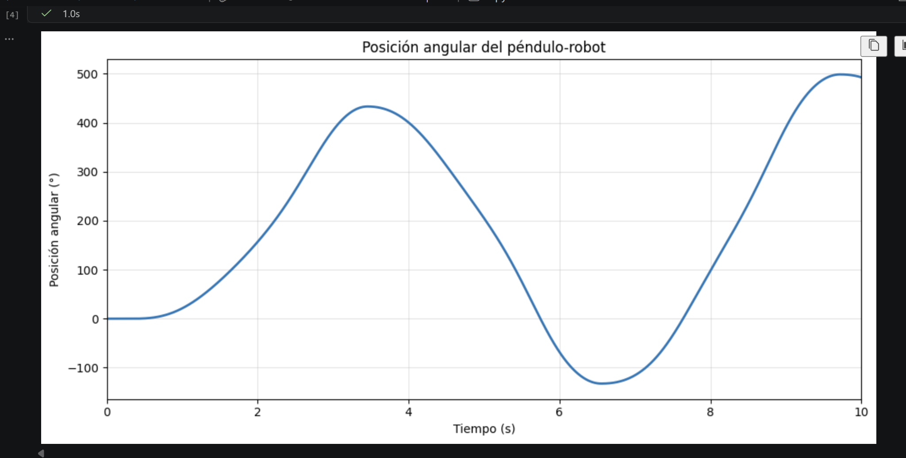
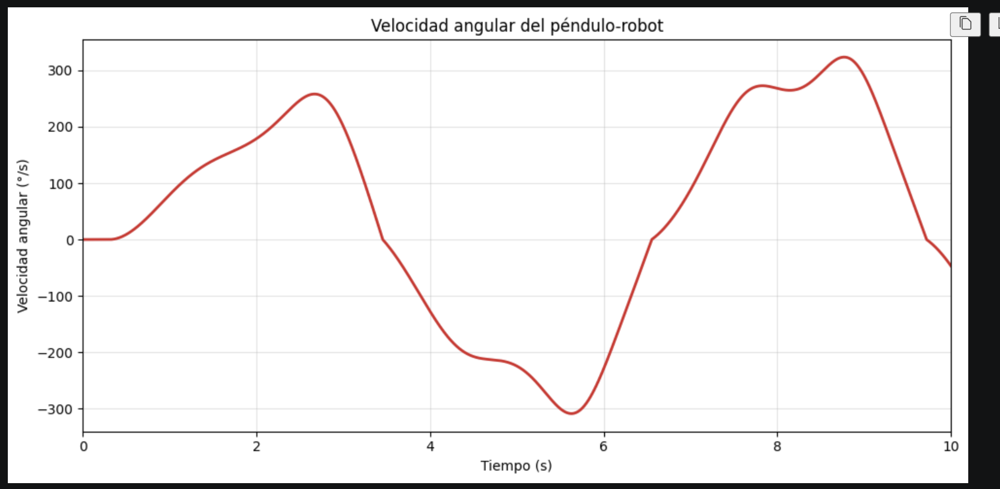

# AF5 - Simulación de un péndulo-robot mediante Euler-Lagrange

## Descripción del proyecto

Este proyecto desarrolla el modelado matemático y la simulación dinámica de un péndulo-robot de un grado de libertad (1 GDL), utilizando el formalismo de Euler-Lagrange y su representación en espacio de estados.

La simulación se implementó en Python mediante herramientas de integración numérica, considerando los efectos de la gravedad, el momento de inercia, la fricción viscosa, la fricción de Coulomb y el par aplicado por el motor.

## Objetivo

Obtener la ecuación dinámica de un sistema mecánico mediante el formalismo de Euler-Lagrange y analizar su comportamiento a través de una simulación numérica durante 10 segundos.

## Parámetros del sistema

| Parámetro | Descripción | Valor |
|---|---|---|
| Ir | Momento de inercia | 0.16 kg·m² |
| m | Masa del mecanismo | 5 kg |
| g | Aceleración gravitacional | 9.81 m/s² |
| lc | Distancia al centro de masa | 0.01 m |
| b | Coeficiente de fricción viscosa | 0.14 N·m·s/rad |
| fc | Fricción de Coulomb | 0.45 N·m |

## Modelo matemático

La ecuación dinámica del sistema, obtenida mediante el formalismo Euler-Lagrange, es:

**0.16q̈ + 0.14q̇ + 0.4905sin(q) + 0.45tanh(100000q̇) = 1.5sin(t)**

Donde:

- q: posición angular.
- q̇: velocidad angular.
- q̈: aceleración angular.
- t: tiempo.

El sistema considera un par de entrada sinusoidal:

**τ(t) = 1.5sin(t)**

## Representación en espacio de estados

Se definen las variables de estado:

- x₁ = q
- x₂ = q̇

Por lo tanto, las ecuaciones de estado son:

**ẋ₁ = x₂**

**ẋ₂ = [1.5sin(t) − 0.4905sin(x₁) − 0.14x₂ − 0.45tanh(100000x₂)] / 0.16**

Las condiciones iniciales son:

- x₁(0) = 0 rad
- x₂(0) = 0 rad/s

## Herramientas utilizadas

- Python
- NumPy
- SciPy
- Matplotlib
- Jupyter Notebook
- Visual Studio Code

## Resultados de la simulación

La simulación se realizó durante 10 segundos y permitió visualizar el comportamiento de la posición y velocidad angular del péndulo-robot.

### Posición angular

### Velocidad angular

Los resultados muestran un comportamiento dinámico no lineal, con variaciones en la posición y velocidad angular producidas por la interacción entre el par aplicado por el motor, la gravedad y las fuerzas de fricción.

## Ejecución del programa

1. Descargar el archivo `AF5_Modelado_y_Simulacion_Pendulo_Robot.ipynb`.
2. Abrirlo en Jupyter Notebook, Visual Studio Code o Google Colab.
3. Instalar las bibliotecas NumPy, SciPy y Matplotlib si todavía no están disponibles.
4. Ejecutar todas las celdas del notebook.
5. Visualizar las gráficas de posición y velocidad angular.

## Referencias

- Material de la actividad AF5: Simulación de un sistema a partir de ecuaciones de Euler-Lagrange.
- Reyes Cortés, F. *Robótica: control de robots manipuladores*. Alfaomega.
- Documentación oficial de Python, NumPy, SciPy y Matplotlib.

El desarrollo tomó como referencia un ejemplo público de simulación de un péndulo-robot de 1 GDL, adaptado y documentado para los objetivos de la actividad.
